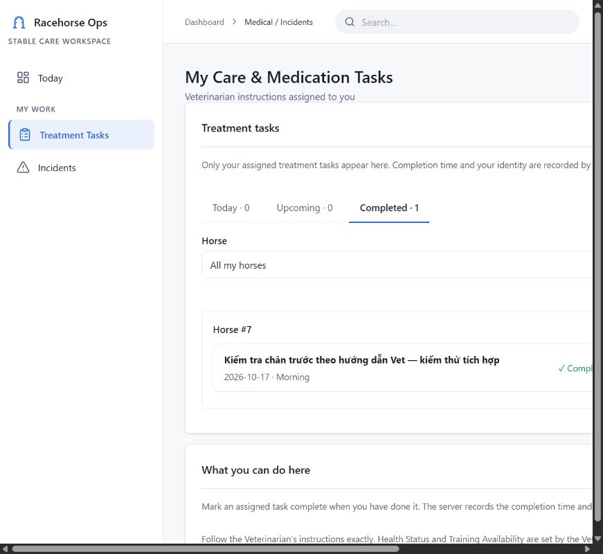

# CORE-036 / CORE-046 — official FE integration handoff

Owner: Nguyễn Đình Minh Đức. Date: 2026-10-17 (Asia/Bangkok).

This handoff follows the Leader's OFFICIAL FE INTEGRATION instruction. Official destination is **dev**, not the harness. No merge, force push, PR retarget, shared adapter edit or implementation change to CORE-013/027/029 was performed.

## 1. Verified branches and scope

| Purpose | Branch | Exact revision |
| --- | --- | --- |
| Official FE | `dev` | `f7c290d100c77ba6d33cf781aed9102f73c8a1bc` |
| Integrated product reference | `feat/dev-ui-harness` | `6a7b6f4cf8ef67a2bbf9e862696a35540417525b` |
| Leader UI reference | `feat/long-core013-027-029-ui` | `8c19ac0bcdf765cdf743d35a3ebd5ceead16060c` |
| Preserved Medical/Groom integration code | `feat/CORE-036-046-incident-integration` | `9449ec26e803b114da38844f4dee08e48b7373cd` before this documentation-only delivery |
| CORE-036 update | `feat/CORE-036-vet-medical-clean` | `a605a7db7b43c36885c948d520007c428fdcd1a3` |
| CORE-046 update | `feat/CORE-046-treatment-groom-fe-stacked` | `d19cb354f8599f100edf85a2a5d54827ba783d34` |

Existing PRs remain Draft: [CORE-036 #8](https://github.com/lamphilong2004/SWP391_Racehorse-Training-Management-System_FE/pull/8), base `dev`; [CORE-046 #5](https://github.com/lamphilong2004/SWP391_Racehorse-Training-Management-System_FE/pull/5), base `feat/CORE-046-incident-report-modal-shared`. Both scoped code updates were pushed normally. No new large integration PR was created.

## 2. Difference matrix: preserved integration versus harness

| Area | Same / already integrated | Changes worth keeping | Harness-only / missing from preserved branch | Integration action |
| --- | --- | --- | --- | --- |
| Medical views | Same clinical models, Case/Exam/Injury/Plan/Recovery UI and shared components | Working Cancel on create/plan, save-success feedback; new contract length validation and invalid-ID route handling | Connection to global business actor/store | Keep module changes; use harness transport boundary, not `medicalTransport` + `medicalDemo` |
| Groom / Incident pages | Product pages match, including task period/horse filters, explicit reporting and reporter-safe details | Reject invalid task/incident IDs and null success data | Shared session error handling already wired by Leader | Keep client validation; retain Leader's `requestApi` transport and auth error callback |
| Incident routes | Both compose Vet review and reporter views | Clinical review handlers remain owned by CORE-036 | Harness has `IncidentRoutes.tsx` with nested routes | Keep one Leader-owned canonical route per screen; do not add `IncidentDetailSwitch` alongside it |
| `router.tsx` / `routePaths.ts` | Shared paths for Medical and Incident | Module-only changes do not require replacing router | Horse, Training, Groom precheck, Rider, Account, dev/present tools | Preserve existing tree; no whole-file checkout from the Medical branch |
| `navigation.ts` | Same canonical navigation system | Treatment Tasks entry already present in harness | Entries for other roles/modules | Keep harness navigation; no replacement |
| `AuthProvider` | Same official provider and role model | No new provider/token issuer needed | Leader's business actor registration; dev-only injected identity API in existing harness | Preserve current provider and injection; feature services accept the resulting actor/session |
| MedicalService | Same CORE-006 endpoints and payloads | Input/route checks | Harness goes through shared `requestApi` selection | Keep service contract; remove secondary source selection only as part of approved glue |
| Core046Client | Same business endpoints | New ID/null guards | Harness uses shared request/error handling | Small manual reconciliation of `client.ts`; keep shared implementation |
| Sample data | Both persist a linked clinical/task graph | Strict own-row scope and close/terminal guards from Medical demo are useful reference | Harness owns Horse/Program/Session graph and shared IDs | One store and one selection point; transfer rules, not a second seed/store |
| Design System / modal | DS and `src/shared/incidents/*` match official dev | Reuse unchanged | None needed for this delivery | No DS/modal files changed |

The old Medical store uses horses 101–104, cases 1/2, incidents 21–23 and tasks 41–44. Harness seed uses horse 7, case 501, incident 601, task 701, Groom 16 and one `nextId`. Equal numeric IDs from two stores do not establish entity identity. Do not merge storage blobs or apply an arbitrary numeric offset.

## 3. Changes completed within ownership

**CORE-036, commit `a605a7d`:** six files under `src/features/medical` only. Ported existing Cancel/back and saved-plan feedback; added OpenAPI length validation for reason/diagnosis/injury metadata and plan/Groom text; invalid case/treatment routes now return not-found without throwing synchronously or making a medical request. Tests cover invalid routes, rejected inputs, preserved edits and Cancel. No router, provider, data adapter or other module was changed.

**CORE-046, commit `d19cb35`:** `client.ts` and `client.test.ts` only. Invalid resource IDs are rejected before HTTP; a null success envelope cannot confirm task completion. No auth/session/router rewrite and no change to the merged IncidentReportModal.

The original integration code remains preserved at `9449ec2`. New official module changes are not silently duplicated into it or into Leader's branch. `CORE-036-046-module-delta-on-harness.patch` packages only the eight Medical/client files, including the client adaptation to Leader's shared transport. It is a proposed patch against harness `6a7b6f4`, not an applied integration or a request to merge harness into dev.

## 4. Conflicts and dependency

- Updated CORE-036 versus current dev: clean in `git merge-tree`; versus harness: also clean. This is a simulation, not a merge or Gate approval.
- Updated CORE-046 versus dev: conflicts in `src/app/router.tsx` and `src/app/router.test.tsx`.
- Updated CORE-046 versus harness: conflict in `src/features/core046/client.ts`; the ID/null checks must be adapted around Leader's shared `requestApi` implementation. That adaptation was exercised only in a disposable compatibility snapshot.
- Whole `9449ec2` versus the integrated Leader UI already has shared hotspots in `.env.example`, router/tests, CORE-046 auth/client/tests and login. Do not import that branch wholesale.
- CORE-002 and CORE-008 are effective on FE dev; merged PR #4 supplies the modal. CORE-006 contract is effective on BE dev `8b2e22a2aee710cc2ac9b3d1c372cb444ac9e21a`.
- Runtime dependencies remain CORE-007 auth, CORE-026 Incident, CORE-035 Medical/Treatment/Groom and CORE-019 restriction/availability. Contract presence is not proof that these runtimes, FK migration or SQL RBAC are ready.

## 5. Proposed single shared Sample Adapter

Target: **Product UI → Feature Service → common transport selection → shared Sample Adapter or Real API**.

Keep `businessData.ts`, `sampleTransport.ts`, `sampleStore.ts` and `racehorse.business-samples.v1` as the integration boundary. `MedicalService` and `Core046Client` call the shared transport. No `medical-demo.v2` read/write and no independent `VITE_MEDICAL_DATA_SOURCE` branch in the final composition. Keep old published demo code available as a reference until Leader approves reconciliation.

Suggested owner split, pending Leader decision:

1. Đức owns a Medical/Groom handler or rule implementation using **injected shared state/actor/clock/ID allocator**, without localStorage, seed creation, network calls or an AuthProvider.
2. Leader owns dispatch, shared schema/version, Horse/Session mapping, transaction/persistence boundary, dev-only identity injection and router/nav composition.
3. All handlers operate on the same current `SampleData`; save once after a successful mutation. Re-read the store across account changes. Existing entity IDs and Horse/Session references remain authoritative.
4. Use strict `assignedGroomUserId === actor.id`. Incident own-report scope must apply to list and detail. Return a Groom-safe projection without case/diagnosis/prescription fields.
5. Match G3: independent case creation remains independent; Incident links only through OPEN_CASE/LINK_CASE review. RESOLVED is terminal; linking requires an OPEN same-horse case. Report only on explicit approved user action.
6. Preserve Completed task IDs/history when replacing pending assignments. Recovery never lifts restrictions. Close requires the exact CORE-006 prerequisites, including restrictions; no inferred availability from recovery.
7. Use registry-backed horse IDs and health/restriction mapping. Initialize required shared seed state before availability reads, regardless of which menu was opened first. Do not copy the Medical demo's hard-coded health map into the Horse module.
8. `dev:present` keeps the existing development-only actor through the official provider and existing adapter. It must not send that identity to real APIs. Production and genuine API mode retain real auth/RBAC. An API failure remains an error, without sample fallback.
9. A sample entity has no implied SQL identity. When related entities are sample-sourced, do not send their IDs to real write endpoints. A later real-API transition requires validated complete related-entity mapping.

Persistence is browser-local **per origin**. Different ports, browser profiles or machines do not share this database. Do not automatically merge/reset existing local datasets. Leader should choose an explicit migration or disposable-scenario reset policy.

## 6. Shared adapter contract evidence

Attachment: `CORE-036-046-shared-adapter-contract.patch`. It adds tests only; it is **not applied to any official branch**. Apply and run in a disposable checkout of harness `6a7b6f4`:

```powershell
git apply --check <path-to-patch>
git apply <path-to-patch>
npm test -- src/shared/data/medicalSamples.contract.test.ts --maxWorkers=1 --reporter=verbose
```

Result against the unchanged harness adapter: **3 PASS / 4 FAIL**.

| Contract | Result / evidence |
| --- | --- |
| Incident → Case → Exam/Injury → Plan → assigned Groom → Recovery/Close; one persisted graph; no fetch | PASS |
| Completed history survives plan replacement | PASS |
| Closure blocked by incomplete treatment/unresolved incident | PASS |
| A second Groom cannot list task 701 assigned to Groom 16 | FAIL: hard-coded `|| assignedGroomUserId === 16` exposes it |
| A second Groom cannot complete task 701 | FAIL: completion uses the same broad filtered set |
| A second Groom cannot list incidents reported by Groom 16 | FAIL: hard-coded reporter exception exposes them |
| RESOLVED cannot OPEN_CASE | FAIL: resolved unlinked Incident transitions back to UNDER_REVIEW |

These are local sample contract defects, not evidence of a deployed BE vulnerability. Fixing them belongs to the approved shared-adapter integration work; no shared implementation was changed in this delivery.

Browser additionally reproduced `Horse not found in sample data` in availability when entering Medical before Horse registry initialization. Keep this as a shared initialization/mapping issue; do not hide it with a fabricated AVAILABLE response.

## 7. PR plan toward official dev

1. **CORE-036 PR #8 → dev:** review the Medical-only change. Existing Incident UI functions need the approved shared route glue; do not claim the PR alone registers Incident routes. Resolve Figma/contract limitations explicitly in Gate.
2. **CORE-046 PR #5:** keep temporary stacked base for review until reconciliation is prepared. Modal dependency is already in dev. Reconcile with effective CORE-008 auth and the canonical Incident route composition; preserve the client fixes. Do not merely change the base and resolve router conflict by replacing the file.
3. **Shared integration glue:** obtain Leader's ownership decision first. Prepare a small scoped integration change for auth/router registration and shared adapter rules; keep it separate from unrelated Horse/Training/Rider implementations. Official final PRs target dev after approved dependencies are effective. No 24-commit harness import.
4. After Leader's dependency/merge order is fixed, port only the missing module delta into the active integrated website and verify route/actor/source compatibility again on the final composed HEAD. Avoid merging CORE-046 twice through #5 and the old integration branch.

## 8. Verification and evidence boundaries

| Target | Result |
| --- | --- |
| Exact CORE-036 code HEAD `a605a7d` | 122/122 tests, ESLint, typecheck, production build and git diff check PASS |
| Exact CORE-046 code HEAD `d19cb35` | 98/98 tests, ESLint, typecheck, production build and git diff check PASS |
| Harness `6a7b6f4` + scoped module changes in disposable snapshot | Whole suite 255/256 PASS; one CORE-022 timeout. ESLint/typecheck/build PASS |
| Focused composed regression suite | 130/130 PASS across 16 files: Medical, CORE-046, auth/session, app routes, shared session samples, dev identity, Horse, Groom precheck and Rider |
| Adapted shared-transport client with new regression cases | 10/10 client tests PASS; module patch checked/applied against a canonical source snapshot |
| CORE-022 unchanged file recheck | 16/17 PASS; same `clears dates, phase lineage and Trainer state when version/template/horse changes` test timed out at 5000 ms. No timeout increase, test weakening or CORE-022 source edit |
| Proposed shared contract | 3/7 PASS, 4 failures documented above; separate from the existing suite |
| Browser `dev:present`, disposable composed snapshot | Normal local presentation login Vet → Medical → Cancel/back → save plan → logout → login Groom → see exact assigned instruction → complete task → reload → Completed still present |
| Real CORE-007 browser / SQL / RBAC integration | NOT VERIFIED |

The compatibility snapshot is **not** a published harness HEAD or official-dev acceptance. Original default-worker runs also encountered a gallery timing failure; exact committed module verification used `--maxWorkers=1`, without changing tests/timeouts. Build has an existing non-failing >500 kB chunk warning on the composed site. No developer auth marker/toolbar was found in its production bundle search.

Browser evidence uses the existing `npm run dev:present` at `http://127.0.0.1:5190`, local presentation users Vet/Groom, on the disposable snapshot. It is UI/sample verification, not real authentication. The screenshot below is a functional check at a narrow viewport, not Figma/pixel acceptance.



Figma source inspected: `tm7dpgAQbHReZ7tlQeQJlc`, Herd Health `267:1223`, Treatment `270:1588`, Groom `252:843`, Incident list `256:1015`, Incident detail `257:1112`. CORE-006 Flow 3 request paths/enums and text limits were used. Full Figma PASS is not claimed: roster/availability totals, structured medication/Vet notes, photos/reviewer/clinical timeline and 3D model expectations still need approved API/design dispositions. No extra schema or API was invented to fill them.

## 9. Decisions needed from Leader before final composition/merge

- Approve the exact shared-glue ownership split and destination/merge order; designate the integration owner for dispatch/store/auth/router changes.
- Resolve the four sample contract failures and horse initialization/mapping issue, or assign the shared-adapter patch work explicitly to Đức.
- Confirm one source-selection configuration and storage migration policy. Retire the competing medical demo from the final composition, while preserving published history.
- Confirm handling of mandatory Figma fields unavailable in the current contract and the 3D fallback scope; supply real runtime/account source when CORE-007 is ready.
- Independent Gate must run against the eventual composed HEAD and distinguish UI/sample checks from real BE/SQL/RBAC. Neither task is marked Done by this handoff.
