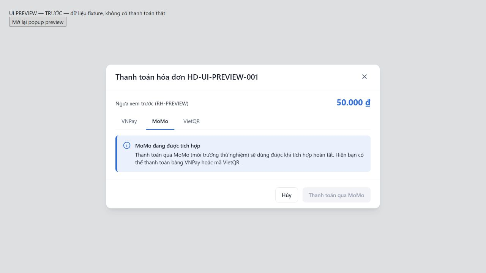
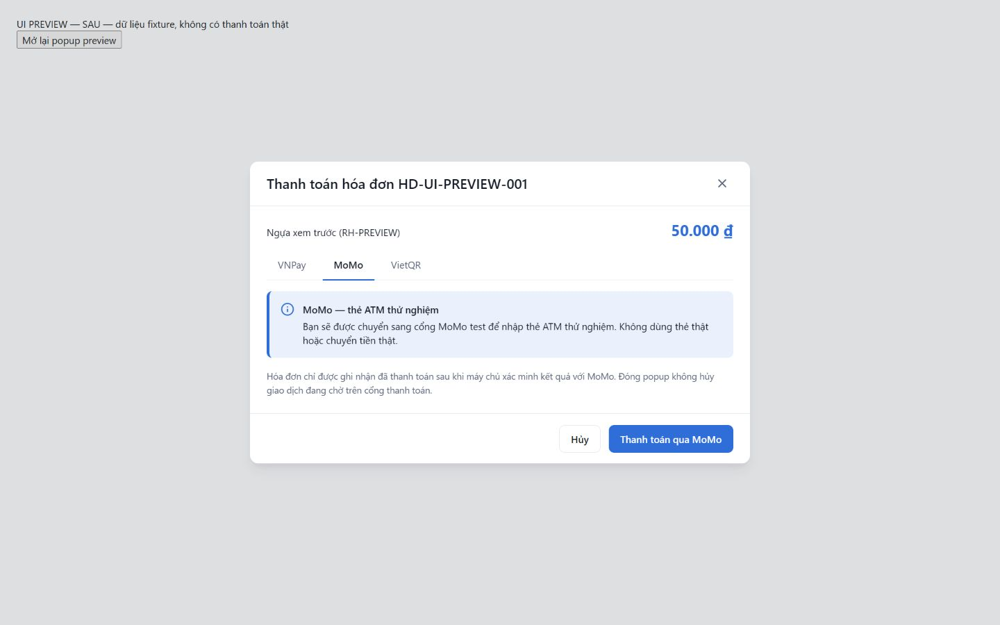
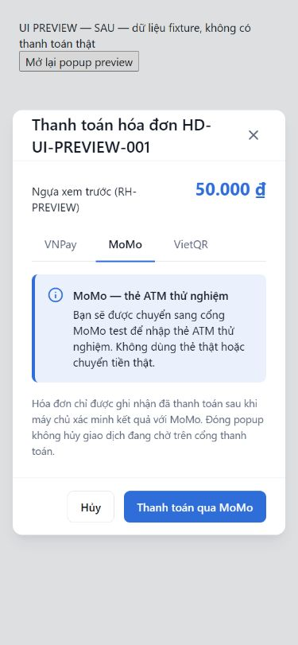
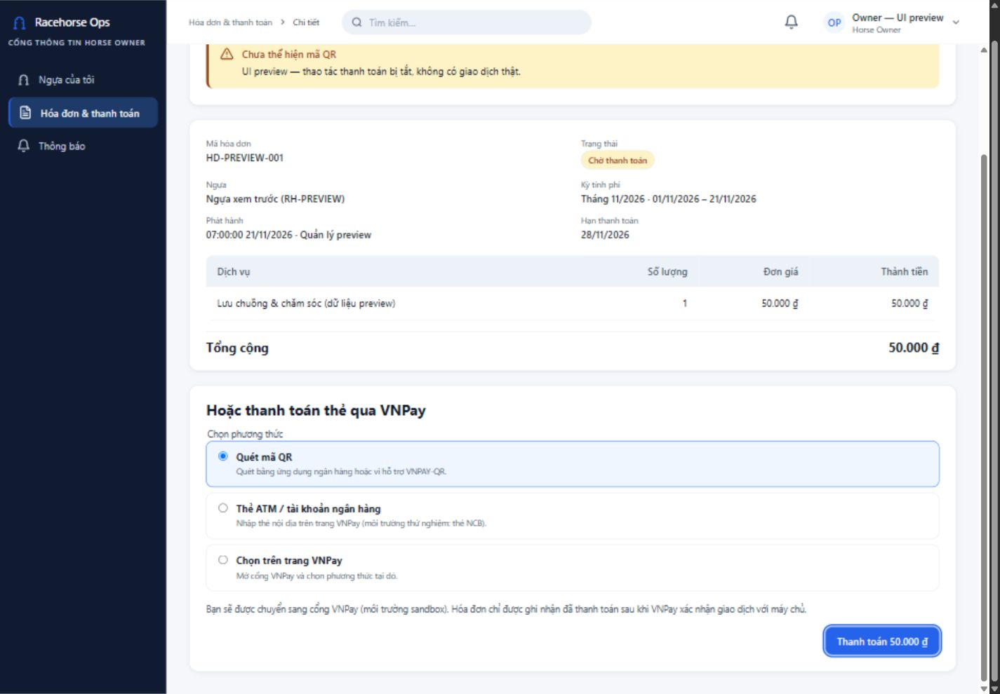

# MoMo ATM UI — Issue #63

Changes: MoMo checkout now lives in `MomoPayTab` and the footer of `PayInvoiceModal`, shared by invoice list and detail. There is no separate MoMo card on the detail page. Submission/pending guards are shared across VietQR/VNPay/MoMo; the return route, provider labels and Vietnamese errors are preserved. Existing Racehorse Modal/Tabs/Button/AlertBanner and tokens are reused.

## Preview evidence

These screenshots use an **explicit local UI fixture**, with synthetic names, a preview invoice, and all payment writes rejected. They show UI only; they are not evidence of a real MoMo sandbox payment. No fake login/payment code is included in the application source or production bundle.

### Current shared popup

Before: reviewed FE #73 at `5fa25a9`, placeholder tab. After: MoMo tab/footer integration in #71. All images visibly identify the UI fixture.

- Inspected at 1440, 1280, 1024, 768 and 375px: document/dialog widths stay within the viewport; footer actions remain visible. The pending-order footer wraps on mobile. Amount/currency stay on one line.
- Keyboard arrows switch tabs; Tab reaches modal controls. Escape cannot dismiss during a submission. A rejected fixture write keeps the invoice unpaid, displays an error and allows retry after refreshing state; Escape closes once idle.
- UI fixture has no real payment API or successful write; browser evidence cannot establish gateway settlement.

### Historical inline-card evidence (superseded UI)

- Before: PR #70 HEAD `cb2eb2af`, Owner invoice page.
- After: candidate MoMo panel under the VNPay block, visible keyboard focus.
- Desktop 1440px inspected. 375px and 812px viewport checks found no document horizontal overflow. Mobile screenshot capture did not provide reliable visual evidence, so no mobile visual PASS is claimed.
- Browser fixture click returns an explicit error; the invoice stays unpaid and no success is shown.

## Validation

`npm run typecheck`, `npm run lint`, `npm run build`: PASS.

Current full `npm test`: **1278 passed**, 114 files; typecheck/lint/build PASS. The earlier FE #70 integration had 1266 passed; that count is historical. Tests cover unavailable configuration, shared pending locks (including locally expired MoMo orders), double-click across methods, failure/retry, uncertain create retaining a pending order, rejecting a non-sandbox URL, signed-return cancellation, and a successful-looking browser return that stays pending until server confirmation.

Recheck:

1. Start the paired BE candidate after its reviewed migration on a dedicated new DB.
2. Sign in as an Owner, open an own unpaid invoice. Other owners must not gain access.
3. Configure MoMo merchant **test** credentials in BE, open **Thanh toán** from list/detail, select **MoMo**, then choose **Thanh toán qua MoMo**. Use only the provider's official ATM test instructions. Open FE and return on the same `localhost:5173` origin.
4. Return through `/thanh-toan/momo`; verify PAID and MoMo history only after the BE query/IPN confirms.
5. Repeat with cancellation, incorrect signature/amount, lost network and two tabs. No extra payable transaction should be created.

## Review scope and remaining acceptance

Long [authorized Ready with a limited scope](https://github.com/lamphilong2004/SWP391_Racehorse-Training-Management-System_BE/issues/63#issuecomment-7076465907): create ATM test order, redirect to MoMo, cancel/fail and return through server signature validation. This does **not** mean a successful payment has been accepted.

Long's [reported real dry-run](https://github.com/lamphilong2004/SWP391_Racehorse-Training-Management-System_BE/issues/63#issuecomment-7075910449) used BE `98550a8` / FE `d946301`, copy DB `Racehorse_dec016_dryrun`: order creation/redirect worked; cancel returned 1006, payment FAILED, invoice ISSUED. This is evidence from Long's environment and the earlier inline UI, not a claim that Duc independently ran the new popup against the gateway.

**Successful ATM payment remains PENDING.** Public merchant test settings are available, but this session's PowerShell and Java create requests received HTTP 403. Long's ATM success attempt was issuer-declined; no current official ATM phone/card combination has been verified. No PAID success screenshot exists. Both PRs can be Ready for the limited review above; Long decides whether to merge. No self-merge/deploy or existing demo DB/account/launcher change was performed.
