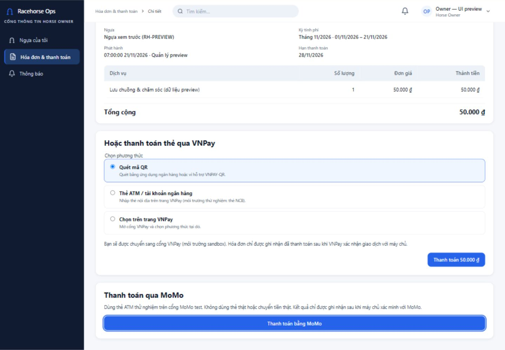

# MoMo ATM UI — Issue #63

Changes: Owner invoice detail, shared submit/pending guard across VietQR/VNPay/MoMo, MoMo return route, provider labels and Vietnamese errors. Existing Racehorse Card/Button/AlertBanner components and styles are reused.

## Preview evidence

These screenshots use an **explicit local UI fixture**, with synthetic names, a preview invoice, and all payment writes rejected. They show UI only; they are not evidence of a real MoMo sandbox payment. No fake login/payment code is included in the application source or production bundle.

- Before: PR #70 HEAD `cb2eb2af`, Owner invoice page.
- After: candidate MoMo panel under the VNPay block, visible keyboard focus.
- Desktop 1440px inspected. 375px and 812px viewport checks found no document horizontal overflow. Mobile screenshot capture did not provide reliable visual evidence, so no mobile visual PASS is claimed.
- Browser fixture click returns an explicit error; the invoice stays unpaid and no success is shown.

## Validation

`npm run typecheck`, `npm run lint`, `npm run build`: PASS.

Full `npm test`: **1263 passed**, 112 files. New tests cover unavailable configuration, shared pending locks (including locally expired MoMo orders), double-click, failure/retry without losing invoice context, and a successful-looking browser return that remains pending until server confirmation.

Recheck:

1. Start the paired BE candidate after its reviewed migration on a dedicated new DB.
2. Sign in as an Owner, open an own unpaid invoice. Other owners must not gain access.
3. Configure MoMo merchant **test** credentials in BE, then choose **Thanh toán bằng MoMo**. Use only the provider's official ATM test instructions.
4. Return through `/thanh-toan/momo`; verify PAID and MoMo history only after the BE query/IPN confirms.
5. Repeat with cancellation, incorrect signature/amount, lost network and two tabs. No extra payable transaction should be created.

**PENDING:** no merchant test keys are available; live sandbox ATM payment, its screenshots, and full authenticated browser flow have not been verified. The PR stays Draft until that acceptance is complete. No merge/deploy or demo DB migration was performed.
